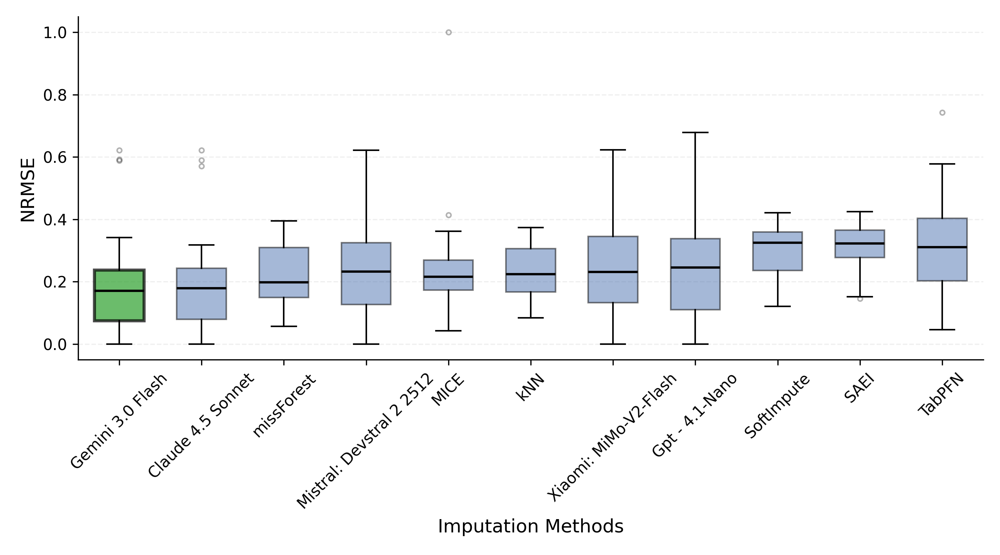
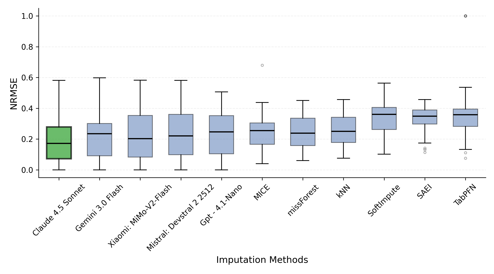
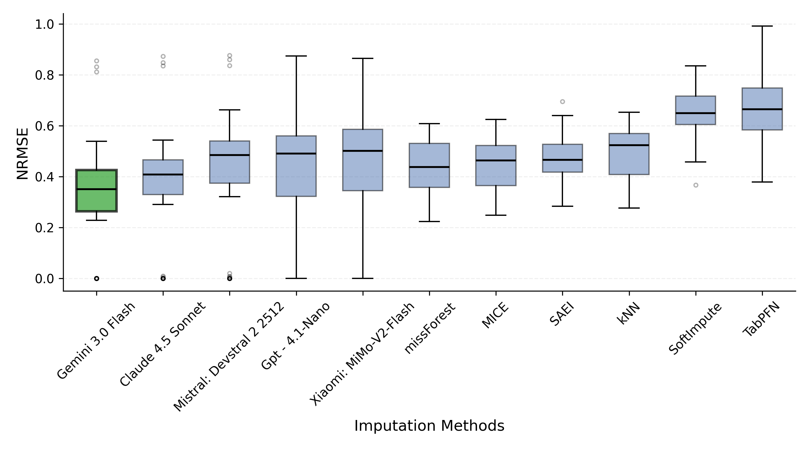
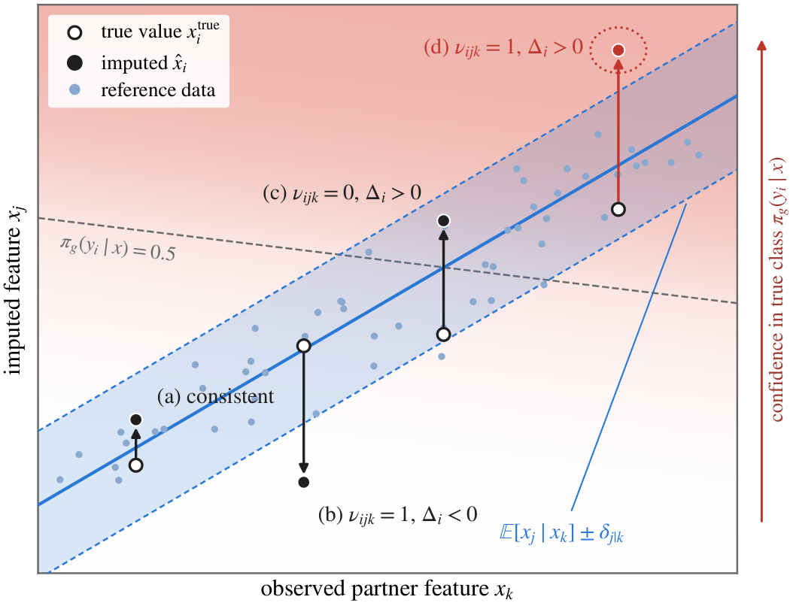
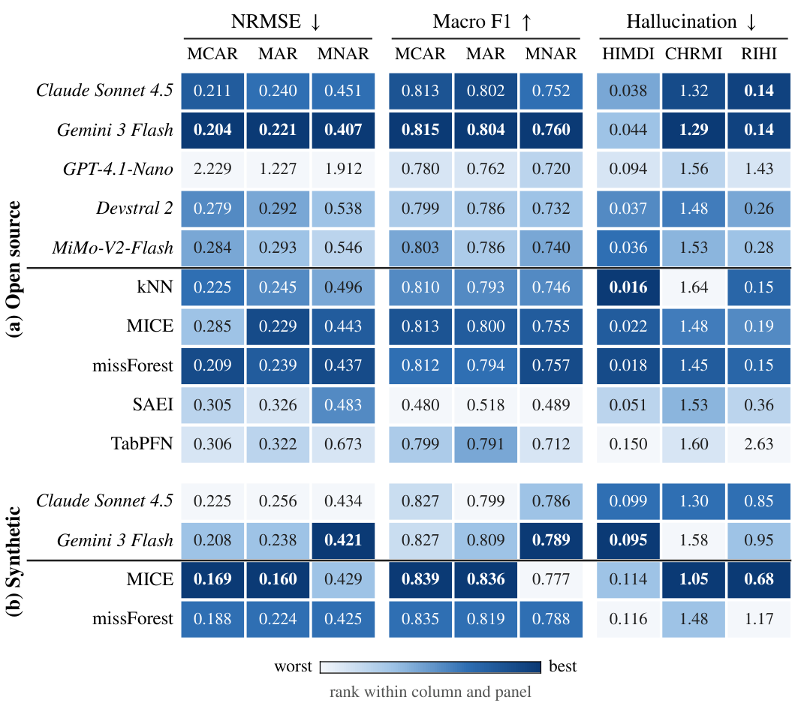
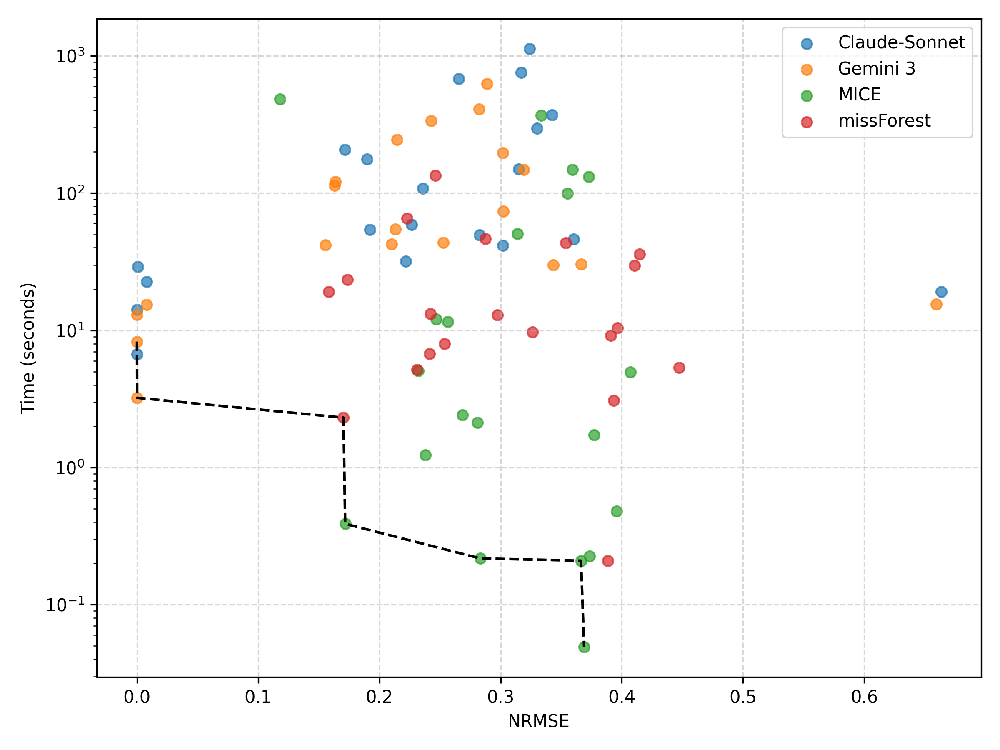

# Large Language Models for Data Imputation: Behavior, Hallucination Effects, and Control Mechanisms

This repository provides a comprehensive experimental framework for evaluating Large Language Models (LLMs) in the context of missing data imputation. The study investigates both performance and behavioral aspects, including hallucination effects and control mechanisms.

## Overview

We evaluate five LLM families across different architectures, including:
- Mistral
- Claude
- GPT
- Gemini

These models are benchmarked against traditional and state-of-the-art imputation methods:
- k-Nearest Neighbors (kNN)
- Multivariate Imputation by Chained Equations (MICE)
- missForest
- Stacked Autoencoder Imputation (SAEI)
- TabPFN

Experiments are conducted under the three standard missing data mechanisms:
- Missing Completely at Random (MCAR)
- Missing at Random (MAR)
- Missing Not at Random (MNAR)

## Results

Empirical results indicate that **Claude 4.5 Sonnet** and **Gemini 3.0 Flash** consistently outperform baseline methods across all missingness mechanisms.

### MCAR


### MAR


### MNAR


In terms of computational efficiency, LLM-based approaches require significantly more resources compared to traditional imputation methods.

## Hallucination Metrics

An imputed value that differs from the ground truth is an *imputation error*, not necessarily a *hallucination*: the true value is never available to the model at inference time. Following the MOWI framework (Model, Observer, World, Input) of Ho et al. (2026), we consider an imputed value a hallucination when it is **(i) not derivable** from the observed data, meaning it violates the relationships among features that the data support, and **(ii) material**, meaning it claims more task-relevant certainty than the true instance warrants. We propose three complementary metrics:

| Metric | MOWI level | Question it answers | Needs ground truth? | Code |
|---|---|---|---|---|
| **HIMDI** | Model | Does the imputed value respect the relational structure of the observed data? | No | [`codes/himdi.py`](codes/himdi.py) |
| **CHRMI** | World | Does the imputation make the instance easier to classify than its true values do? | Yes | [`codes/chrmi.py`](codes/chrmi.py) |
| **RIHI** | Model ∧ World | Is the instance both unsupported *and* materially over-committed? | Yes | [`codes/mowi_index.py`](codes/mowi_index.py) |



*The blue band is the tolerance band $\mathbb{E}[x_j \mid x_k] \pm \delta_{j|k}$ fitted on the reference data, and the red shading is the classifier's confidence in the true class, $\pi_g(y_i \mid x)$. Each arrow goes from the true value (open circle) to the imputed value (filled circle). (a) Inside the band, difficulty preserved. (b) Outside the band ($\nu_{ijk}=1$, counted by HIMDI), but the instance becomes harder to classify ($\Delta_i < 0$): information loss, not hallucination. (c) Confidence in the true class increases ($\Delta_i > 0$, counted by CHRMI) while staying inside the band, so the change is supported by the data. (d) Both unsupported and materially over-committed: only this case contributes to RIHI.*

### HIMDI — Hallucination Index for Missing Data Imputation

Implemented in [`himdi_score`](codes/himdi.py#L31). For each imputed feature $j$ and each partner feature $k$ with at least $n_{\min}=10$ jointly observed training rows, we fit a linear regression $x_j \sim x_k$ on the training fold. The tolerance band follows the split-conformal construction ([`conformal_band`](codes/himdi.py#L16)): $\delta_{j|k} = r_{(\lceil (n+1)(1-\alpha) \rceil)}$, the absolute training residual of that rank, with $\alpha = 0.05$. When the rank exceeds $n$, the band is infinite and the pair never registers a violation. A value drawn from the training distribution therefore falls outside the band with probability about $\alpha$. A cell is a violation when $|\hat{x}_{ij} - \mathbb{E}[x_j \mid x_{ik}]| > \delta_{j|k}$. The per-partner violation rates are averaged using weights $w_{jk} = |\rho_{jk}| + \epsilon$ (Spearman correlation, $\epsilon = 0.01$), and the dataset score is the mean over the features that have at least one evaluable partner. Features with no evaluable partner are excluded rather than set to zero.

HIMDI does not use the true values, so it can also be computed on data that is genuinely incomplete. It is read against two references: the nominal level $\alpha$, and the HIMDI of the ground-truth values themselves. Values far below $\alpha$ indicate smoothing toward the conditional mean (as with kNN, MICE, and missForest), not greater fidelity.

Parameters: `alpha` (band level), `n_min`, `epsilon`. With `return_per_cell=True`, the function also returns the per-cell weighted violation score $v_{ij}$, which RIHI uses.

### CHRMI — Consequential Hallucination Risk for Missing Data Imputation

Implemented in [`train_oracle`](codes/chrmi.py#L78) and [`compute_chrmi`](codes/chrmi.py#L125). A reference classifier $g$ (XGBoost calibrated with Platt scaling) is trained only on the fully observed rows of the training fold. For each test row with at least one imputed value, the difficulty shift is

$$\Delta_i = \pi_g(y_i \mid \hat{x}_i) - \pi_g(y_i \mid x_i^{\text{true}}) \in [-1, 1].$$

- $\Delta_i > 0$: the imputation makes the row *easier* to classify than its true values do, which injects label signal the data do not contain (hallucination).
- $\Delta_i < 0$: the imputation erases true signal, which is a loss of information, not a hallucination.

$$\mathrm{CHRMI} = \frac{1}{|\mathcal{R}|}\sum_{i \in \mathcal{R}} \max(\Delta_i, 0)$$

This is reported as `chrmi_plus`. The signed mean (`chrmi`) and the mean absolute shift (`chrmi_abs`) are also saved. A low CHRMI alone does not mean an accurate imputation, because an uninformative imputation that only erases signal scores close to zero. Read it together with NRMSE and downstream F1. `train_oracle` also reports the classifier's cross-validated accuracy and Brier score (`oracle_acc`, `oracle_brier`), so folds where the classifier is unreliable can be identified.

### RIHI — Relational-Impact Hallucination Index

Implemented in [`mowi_hallucination_index`](codes/mowi_index.py#L22). Per row, $h_i$ is the mean of the per-cell HIMDI scores $v_{ij}$ over the row's imputed cells, and

$$\mathrm{RIHI} = \frac{1}{|\mathcal{R}'|}\sum_{i \in \mathcal{R}'} h_i \cdot \max(\Delta_i, 0).$$

The product acts as a parameter-free soft AND: a row contributes only when it is both relationally inconsistent and materially over-committed. We also report the binary rate

$$\mathrm{RIHI}_{\text{rate}} = \frac{1}{|\mathcal{R}'|}\sum_{i \in \mathcal{R}'} \mathbf{1}\left[h_i > \tau \wedge \Delta_i > \varepsilon\right], \quad \tau = 0.5,\ \varepsilon = 0.05.$$

The code uses the MOWI-based names for these outputs:

| Paper | Output column |
|---|---|
| RIHI | `mowi` |
| RIHI<sub>rate</sub> | `mowi_rate` |
| RIHI with $h_i = \max_j v_{ij}$ (more sensitive variant) | `mowi_max` |
| mean $h_i$ / mean $\max(\Delta_i, 0)$ | `h_mean` / `delta_plus_mean` |

The *Input* level of MOWI (row sparsity, missingness mechanism) is left out of the index on purpose and treated as an explanatory factor.

### Running the metrics

All metrics are computed post hoc from the imputed datasets already saved on disk (LLM-based and classical baselines alike) by [`codes/hallucination_metrics.py`](codes/hallucination_metrics.py):

```bash
python codes/hallucination_metrics.py
```

For each model, mechanism, missing rate, dataset, and fold, the script:

1. Reproduces the original `StratifiedKFold(n_splits=5)` split and loads the saved mask (`results/masks/Datasets/<mechanism>_Mask/`) and the imputed dataset (`results/<model>/Datasets/<mechanism>_Multivariado/`).
2. Maps the classical methods (kNN, MICE, missForest, SAEI, TabPFN), which are saved MinMax-normalized, back to the original scale so they are comparable with the LLM outputs.
3. Computes HIMDI ([L111](codes/hallucination_metrics.py#L111), with `ALPHA = 0.05` set at [L20](codes/hallucination_metrics.py#L20)), trains the reference classifier and computes CHRMI ([L119–L129](codes/hallucination_metrics.py#L119-L129)), then combines them into RIHI ([L131](codes/hallucination_metrics.py#L131)).
4. Writes one row per fold to `results/<model>/Resultados/<mechanism>_Hallucination_v2/<model>_<mechanism>_hallucination_metrics.csv`.

### Overall comparison



*Imputation error (NRMSE), downstream classification performance (macro F1-score), and hallucination metrics (HIMDI, CHRMI ×10², RIHI ×10³) on (a) the open-source and (b) the synthetic datasets. Each cell is colored by the method's rank within its column and panel.*

Imputation accuracy and hallucination are distinct properties. Among the competitive methods, the dimensions diverge. Gemini 3 Flash has the lowest NRMSE and CHRMI, but its HIMDI is about twice that of kNN, missForest, and MICE, whose low HIMDI reflects smoothing rather than greater fidelity. kNN combines the lowest HIMDI with the highest CHRMI. The methods that impute poorly (GPT-4.1-Nano and TabPFN) also hallucinate the most. On the synthetic datasets, which cannot appear in pre-training corpora, the LLMs lose the advantage they show on public data, and MICE leads in most columns.

## Installation

Install the required dependencies:

```bash
pip install -r requirements.txt
```
We recommend using a dedicated virtual environment that could be found [here](LLM).
```bash
source LLM/bin/activate # On Linux/macOS
.\LLM\Scripts\activate   # On Windows
```

## Computational Considerations



LLMs introduce a substantial computational overhead compared to classical methods. This includes:

- Higher latency due to API calls

- Increased monetary cost (depending on provider)

- Dependency on external services

These aspects should be considered when deploying LLM-based imputation in practice.

## Related Publication
```bash
@article{mangussi2026large,
  title={Large language models for missing data imputation: Understanding behavior, hallucination effects, and control mechanisms},
  author={Mangussi, Arthur Dantas and Pereira, Ricardo Cardoso and Lorena, Ana Carolina and Abreu, Pedro Henriques},
  journal={arXiv preprint arXiv:2603.22332},
  year={2026}
}
```
